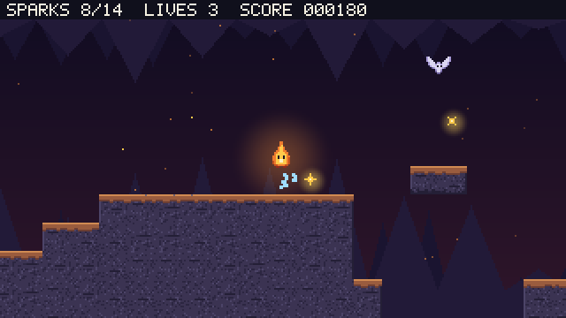

# Underkiln: design notes for the reference solution



This is one way to build the game capstone, about 3000 lines of Rust. It
passes every acceptance test in debug and release, with and without the
`window` feature, and it is meant to be read. These notes explain the
decisions that are not obvious from the code, including a few I would make
differently next time. Your solution may differ in every one of them and
still be good.

The files in this directory are an overlay: copy them over
`capstones/game/` and the package builds as the solution. `Cargo.toml`, the
tests, the font, the sprite sheet, level 1 and the replays are the
starter's, unchanged.

## The map of the code

```text
src/lib.rs        the facade: plain data types, module list, re-exports
  fb.rs           Framebuffer, Sprite: clipping, lines, blit, blend, text, checksum, PPM
  font.rs         the 5x7 font, parsed from the asset file at compile time
  hash.rs         FNV-1a
  rng.rs          SplitMix64
  timestep.rs     FixedStep
  level.rs        level text -> Map (tiles) + spawn lists; tile queries
  store.rs        a generational arena for entities
  game.rs         Game: state, step (SPEC 10), accessors, state hash
  fx.rs           particles (fixed pool) and the shake counter
  art.rs          sprites from the sheet, rock tiles and the flue made in code
  render.rs       Game::render: back to front, HUD, messages
  replay.rs       Replay text format

src/main.rs       argument parsing, error reporting, choice of front end
  headless.rs     replay -> lines of checksums, optional PPM files
  platform.rs     the only file that names minifb (feature `window`)
  play.rs         the real-time loop (feature `window`)
```

The dependency arrows point one way. `fb`, `rng`, `hash`, `timestep` know
nothing about the game. `game` uses `level`, `store`, `rng`, `fx`. `render`
reads `game` and writes through `fb`. The binary uses the library through
the same public facade the tests use, plus nothing else.

## Numbers

Everything is integer. Positions are `i32` subpixels, 256 to a pixel, as
the SPEC prescribes. Two habits kept this painless:

- Constants carry their unit in how they are written: `10 * SUB` is ten
  pixels, `3 * TILE` is three tiles. A bare literal in `game.rs` is a
  speed in subpixels per step, copied from the SPEC table.
- Tile lookups use `div_euclid`, pixel conversions use `>> 8`. Both round
  down. Plain `/` appears only where the operand cannot be negative.

The rasteriser widens to `i64` exactly where two `i32` values are added
(`clip`, the line's error term). That one decision removes every overflow
case in `fill_rect`, `blit` and `line`; there are no special cases for
extreme arguments.

## The entity store

`store.rs` is a generational arena: a `Vec` of slots, each with a
generation counter and an `Option<T>`, and a free list. `Game` keeps the
enemies in it and, next to it, `roster: Vec<(EnemyKind, Id)>` in spawn
order.

Honest assessment: this level format never spawns anything after loading,
so a plain `Vec<Enemy>` with an `alive` flag would have passed every test
with less code. I kept the arena for three reasons.

1. The roster shows the pattern in its natural form. It holds handles that
   outlive what they point to. When an enemy is stomped, it is removed
   from the store and its handle stays in the roster; `store.get(id)`
   returns `None` from then on. "A removed enemy keeps its number and
   reports `alive: false`" falls out of that without a flag to forget.
2. Spawn order is explicit data (the roster) instead of a side effect of
   never removing from a `Vec`.
3. The first stretch goal anyone adds is something that spawns during play
   (a projectile, an enemy generator). The store is ready for it.

The free list is reserved to full capacity when the store is created, so
`remove` cannot allocate in the middle of a frame.

Sparks are a `Vec<Spark>` with a `taken` flag, and the player is a plain
field. Not everything needs a handle.

## Borrowing inside `step`

`step` is split into methods that follow the SPEC's phases:
`step_player` (10.1 to 10.7), `step_enemies` (10.8), `meet_enemies`
(10.9), `collect` (10.10, 10.11), `animate` (12.1).

Inside each, the code borrows *fields*, not `self`: `let p = &mut
self.player;` together with `&self.map` and `self.fx.burst(..)` is fine
because they are different fields. The collision helpers (`slide_x`,
`slide_y`, `overlap`) are free functions that take the map and plain
numbers, for the same reason. Where a method needs all of `self`
(`lose_life`), the field borrow ends first; you can see the re-borrow
`let p = &mut self.player;` right after the call in `step_player`.

Nothing is cloned to satisfy the borrow checker, in `step` or in `render`.

`slide_x` and `slide_y` serve the player and the walkers. A walker asks
`slide_x` "would this move hit a wall?" and throws the snapped position
away, because the SPEC says a blocked walker does not move at all.

## Effects are downstream

`Fx` holds the particle pool, the shake counter and its own `Rng`. The
simulation calls `fx.burst(..)` and `fx.shake(..)` when something
happens; nothing in the simulation ever reads from `Fx`. That one-way
street is why the state hash can ignore effects and why changing a
particle count cannot move an enemy.

The pool is `[Particle; 64]` plus `live`. Removal is a swap with the last
live item. `Fx::age` runs first in a step and spawning comes later, which
gives exactly the lifetime rule of SPEC 12.2 with a single counter per
particle.

## Rendering

`render` draws back to front: gradient, two layers of rock teeth that
scroll at a quarter and a half of the camera speed, drifting motes, water
and rock tiles, the flue, glows, sparks, enemies, Nib, particles, HUD,
messages. Because every frame starts with a gradient over the whole
buffer, "render sets every pixel" is true by construction.

- **Art is built once.** `art::art()` returns a `&'static Art` from a
  `OnceLock`. `Game::new` calls it, so the sprites and tiles are built
  (and their memory allocated) when the first game is created; every
  frame after that only reads them.
- **Rock tiles are generated.** For each of the 16 combinations of "which
  neighbours are open" there are four speckle variants, chosen by a hash
  of the tile position. An open top gets a clay crust, an open bottom a
  ragged shadow. The per-tile neighbour mask is computed once in
  `Game::new`. This was much easier to get looking right than drawing
  tiles by hand.
- **Light is `blend_pixel`.** `glow` blends a colour with a strength that
  falls off with the square of the distance. It costs a few thousand
  blended pixels per frame and gives the picture most of its mood.
- **Interpolation** uses `prev` positions saved at the start of each step.
  `Game::step` saves them for Nib and every enemy before anything else,
  also in a finished game: a won or lost game moves nothing, so `prev`
  must catch up with the position, or the win screen would slide between
  the last two positions as `alpha` changes. A respawn sets `prev` to the
  start position, because a teleport is not a movement. The camera is
  computed from Nib's interpolated position, so the world does not jitter
  against Nib on fast displays.
- **Decoration that moves** (motes, water foam, sprite frames of enemies)
  is a function of `tick`, never of how often `render` was called.

The HUD line is formatted with `write!` into a 64-byte stack buffer
(`Line`), so it does not allocate.

## The font at compile time

`font.rs` parses `assets/font5x7.txt` in a `const fn` and stores the
result in a `static` table. A typo in the font file is a compile error
with a message, and drawing text needs no start-up step. The parser is
plain `while` loops over bytes because a `for` loop is not allowed in a
`const fn` (error E0015 on this toolchain). If that style bothers you, parsing once at start-up into a
`OnceLock` is equally valid.

## Replays and the binary

`Replay::from_text` validates every run and adds up the counts before it
builds the input vector, so a file cannot make it allocate more than the
format's maximum. `to_text` uses `chunk_by` to find runs.

`main.rs` turns every failure into a `String` and exit code 2; the library
has typed errors, the binary does not need them. Arguments are read with
`std::env::args_os` and paths are kept as `PathBuf`: `std::env::args`
panics on an argument that is not valid Unicode, and a file name does not
have to be. `headless.rs` writes
through one `Box<dyn Write>` so that standard output and `--out FILE`
share all code. `platform.rs` is 85 lines and is the only place that
would change for another window crate.

`play.rs` reserves room for an hour of inputs up front. A longer session
would reallocate once; run-length encoding while recording would remove
even that, and is a nice exercise.

Extras that the SPEC does not ask for: a second level
(`assets/level2.txt`, built in; after a win, R goes on to it) and F2 to
save a screenshot while playing.

## How the SPEC was checked

Besides this implementation there is a second, independent model of the
rules: a few hundred lines of Python written from the text of SPEC.md
alone (lines, font, generator, the whole of section 10, the state hash).
It reproduces the line and font checksums used in `tests/m1_raster.rs` and
every line of both golden traces. Two implementations in two languages
agreeing on 1744 steps is the evidence that the SPEC is complete enough to
build from.

A reviewer then wrote a third implementation, in Rust, from SPEC.md alone
and with a deliberately different design: one file, a flat `Vec` of
enemies with an `alive` flag, a font table built at run time, and flat
rectangles for a picture. It passes the acceptance tests and prints the
same state hash as this solution after every one of the 2728 steps of the
three replays (the demo, the losing run and a win of level 2). Writing it
found one test that had been tied to this renderer (a fixed number of
different frames, which only a lively picture reaches) and one bug here
that no test had seen (a finished game kept sliding between its last two
positions); both are fixed, and tests now cover them.

Reference values for this implementation, from
`game --headless --replay assets/demo.replay`:

```text
1 82c948914fc8e9b1 096febf9ca89e97e
1016 61d410ebdc7791ec d59beaf259ecbfad
end phase=won score=590 lives=3 ticks=1016
```

The middle column (state) must be the same for every correct solution. The
last column (frame) belongs to this renderer and its art; yours will
differ. Debug and release builds print identical files. One frame (step,
render, checksum) takes about 0.3 ms on the machine this was written on.

## What I would change

- **Respawning at the level start** is simple to specify and harsh to
  play in a long level. Checkpoints would be kinder; they add state that
  the hash must cover.
- **Mistwings ignore tiles.** It keeps their rule to four lines, but they
  can drift into rock. A leash that respects walls would look better.
- **`glow` is the most expensive thing in a frame.** A precomputed
  falloff table per radius would make it several times cheaper. It was
  fast enough, so it stayed simple.
- **`Game` owns its effects.** A stricter split would keep `Fx` outside
  and let the caller feed it from `Events`. I kept it inside so that
  `render(&self)` has everything it needs and a headless frame checksum
  covers the particles too.
- **`render.rs` is one long function per layer.** A small "sprite list"
  built per frame (in a reused buffer) would make drawing order data
  instead of code, which is the first thing a GPU renderer needs.

## Licence

All code, art, levels and replays here are original work for this course,
under the MIT licence of the course repository. The only third-party crate
is `minifb` (MIT or Apache-2.0), used unmodified as a dependency.
